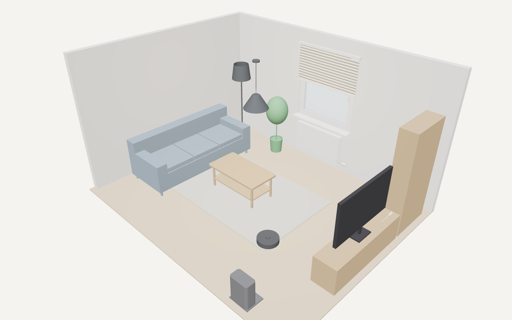
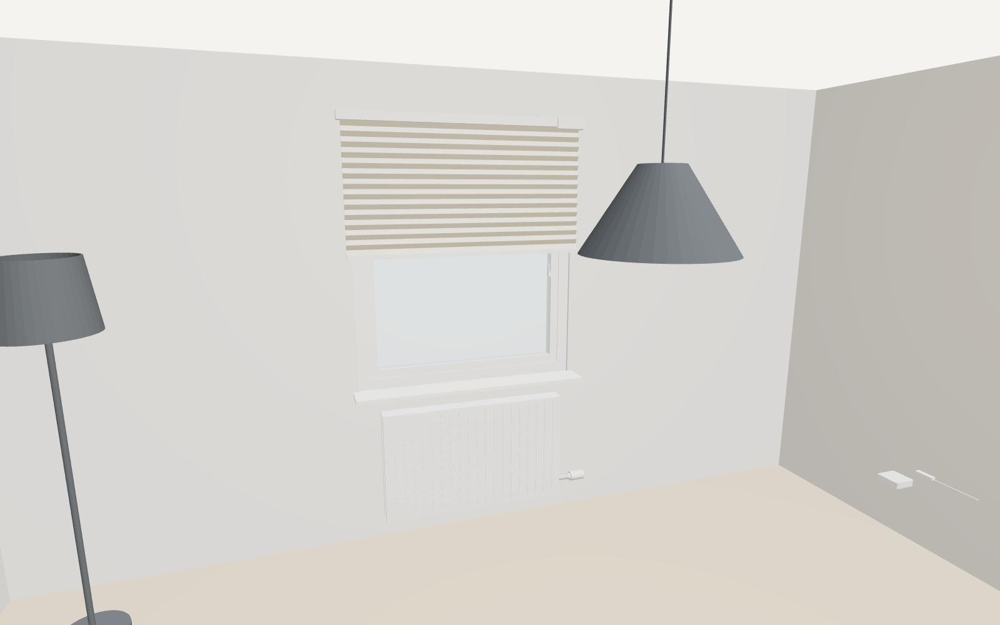
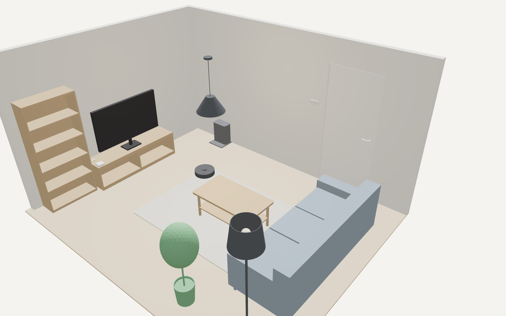

# Smart Room – a complete example living room

A finished, working example of one room in a Home Assistant home: what to buy, every piece
of software it needs, the full configuration, and a 3D model of the room where every part
is its own file.

The room has **automatic blinds, presence lighting, a smart radiator thermostat, open-window
detection, day and night modes, and a robot vacuum that only cleans when nobody is around.**
One device of my own does all the sensing and control: the
**[Room Panel](https://github.com/gustavwrisberg/room-panel)** by the door – mmWave presence,
temperature, humidity, light, CO₂, an e-paper display, a knob and four buttons. Rooms that
don't need everything can use a cheaper build without the screen and/or the CO₂ sensor
([build options](docs/shopping-list.md#room-panel-build-only-what-the-room-needs)).

Everything else is off the shelf (IKEA Matter-over-Thread, a Roborock) and runs locally on
Home Assistant. No door/window contacts: windows are detected from the temperature drop.



**[Open the 3D model in the browser →](docs/viewer/)** (after enabling GitHub Pages, see below)

## What the room does

| Function | How | Hardware |
| --- | --- | --- |
| **Lights** | Someone walks in and it is dark → lights on in the current scene. Room empty for 5 min → off. Neutral white by day, warm in the evening, a 5 % night light in night mode. Scene button cycles Everyday / Cozy / Movie / Bright. | 2 × IKEA KAJPLATS bulbs, panel radar + light sensor |
| **Blinds** | Open at "morning starts" once the sun is up, close at dusk (privacy, and the cellular blind keeps heat in), close in night mode, shade an empty room on hot days. | IKEA HOPPVALS cellular blind + motor |
| **Heating** | 21 °C while someone is there (and 30 min after), 19 °C when empty, 18 °C at night, off while a window is open. Regulates on the panel's temperature, not the reading at the valve. | IKEA LILJEBAGGE + Better Thermostat |
| **Windows** | "Window open" from a fast temperature drop at the panel. Radiator off until the room stops cooling; CO₂ above 1000 ppm suggests airing out (with the CO₂ sensor fitted). | Panel SHT40, SCD40 (optional) |
| **Day / night** | Night mode at 23:00 or with a long press on the panel's all-off button, off at 07:00. Lights, blinds and heating all follow it. | Room Panel |
| **Robot vacuum** | Once a day when everyone has left home (or, optionally, when this room has been empty for 30 min). Back to the dock as soon as someone comes home or presses a panel button. The radar ignores the robot while it cleans. | Roborock, `vacuum.clean_area` |
| **Panel** | Knob dims the lights or moves the blinds; buttons for lights, blinds, all-off/night and scene/auto. The e-paper (optional) shows temperature, CO₂, time and electricity price. | Room Panel |

Details and the reasoning behind each rule: [docs/how-it-works.md](docs/how-it-works.md).

## What you need

**Shopping list:** [docs/shopping-list.md](docs/shopping-list.md) – about **€805** for the room
including the vacuum and the hub; about €150 for the room alone if you already run Home
Assistant and have a vacuum, less with a smaller panel build.

**Software:** [docs/software.md](docs/software.md) – Home Assistant, the Matter Server and
OpenThread Border Router add-ons, ESPHome, HACS with Better Thermostat and Energi Data
Service, and the Roborock integration. All free, all local.

## Repository layout

```
home-assistant/packages/    The whole room as Home Assistant packages (lights, blinds, heating, vacuum, core)
home-assistant/dashboard/   A ready-made dashboard view
esphome/                    The Room Panel for this room (pulls its firmware from the room-panel repo) + build options
hardware/shopping-list.csv  Everything to buy
models/                     3D model: one STL + GLB per part, the full room.glb, the build script
docs/                       Setup guide, how it works, software list, images, web 3D viewer
```

## Quick start

1. Buy the parts on the [shopping list](docs/shopping-list.md), pick a panel build, and build the
   [Room Panel](https://github.com/gustavwrisberg/room-panel).
2. Install the [software](docs/software.md).
3. Follow [docs/setup.md](docs/setup.md): flash the panel from `esphome/`, commission the
   Matter devices, rename the entities, copy `home-assistant/packages/` into `/config/packages/`.
4. Restart Home Assistant and press the scene button on the panel.

The packages pass Home Assistant's `check_config`, and the panel config validates with
ESPHome 2026.11 in both the full and the no-screen build.

## The 3D model

[`models/`](models/) has the room as **39 separate parts**: walls, window, blind, radiator,
valve and thermostat, lamps and bulbs, robot vacuum and dock, hub and Thread radio,
furniture, and the real printable case of the Room Panel. Each part is an
STL in mm (GitHub previews it when you click it) and a coloured GLB, plus `room.glb` with
everything in place. One Python script builds it all, with the room, window, radiator and
panel position as parameters.

| | |
| --- | --- |
|  |  |
| Window wall: blind, radiator with smart thermostat | Door side: Room Panel next to the door, vacuum dock, hub on the TV bench |

**Web viewer:** in the repository settings, turn on **Pages** (deploy from branch `main`,
folder `/`). The viewer is then at `https://<user>.github.io/smart-room/docs/viewer/`. Click
any part to see its size and download its STL.

## Related repositories

| Repo | What |
| --- | --- |
| [room-panel](https://github.com/gustavwrisberg/room-panel) | Room Panel: board, case, firmware – the device this room is built on |

## Status

Example configuration, built for my own Danish setup (district/water heating, Energi Data
Service prices). The Room Panel is rev 1 and **not yet tested on real hardware**; values to
tune per room are marked in the configs. Issues and pull requests welcome.

## License

- **Hardware and 3D models** (`models/`, `hardware/`): [CERN-OHL-S v2](LICENSE-HARDWARE). The
  Room Panel case in `models/devices/` comes from its own repo under the same licence.
- **Software and configuration** (`home-assistant/`, `esphome/`, `models/*.py`, `docs/viewer/`): [MIT](LICENSE-SOFTWARE).

Product names (IKEA, Roborock, Home Assistant) are only used to say which products the
example uses; the 3D stand-ins are generic shapes, not copies of those products.
