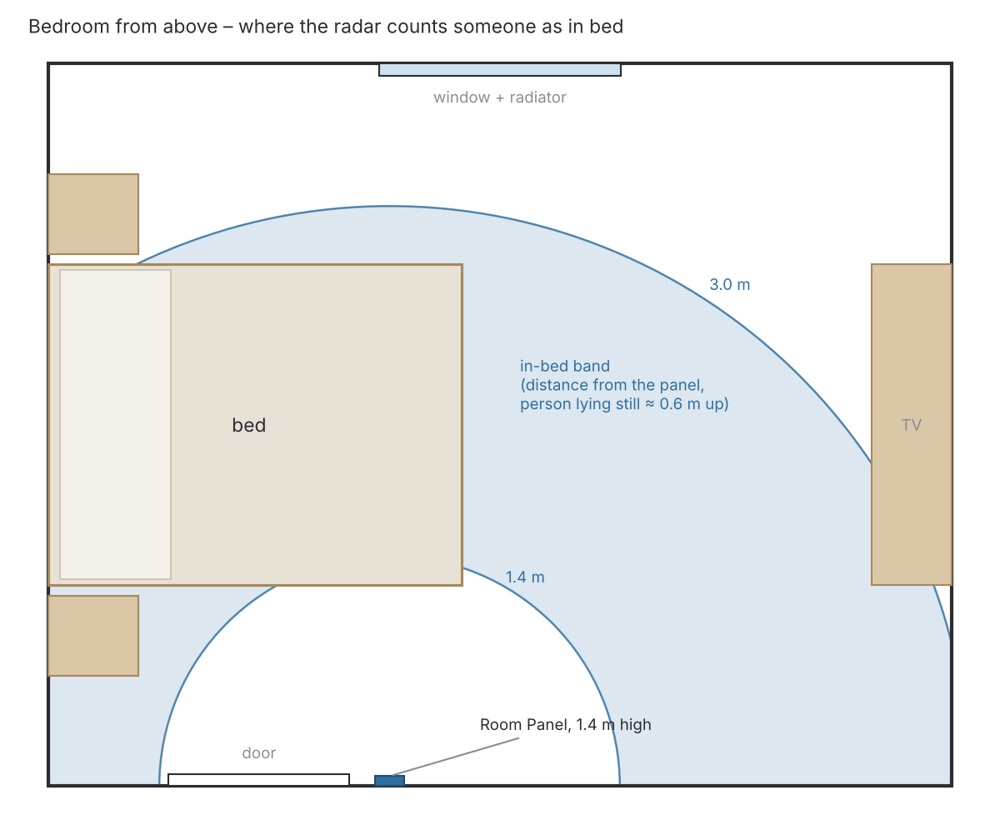

# How it works

The bedroom is six Home Assistant packages in [`home-assistant/packages/`](../home-assistant/packages/).
Every automation only runs while `input_boolean.bedroom_auto` is on.

```
 Room Panel (by the door)                         ┌── lights (KAJPLATS, Thread)
   C4002 radar, SHT40,  ──── Home Assistant ──────┼── blind (cover)
   BH1750, SCD40*,           bedroom_core:        ├── radiator (LILJEBAGGE + Better Thermostat)
   e-paper*                  presence, in bed,    ├── vacuum (Roborock)
   knob + 4 buttons ──────── night mode, scripts  ├── phone warnings (Companion app)
                                                  └── panel display* (temperature, CO₂, price)
 Weather (Met.no) ────────── outdoor temperature, sunshine

 * optional: the panel works without the screen and/or the CO₂ sensor
```

| Package | Does |
| --- | --- |
| `bedroom_core.yaml` | Presence, in-bed detection, outdoor temperature, heating target, night mode, the panel's scripts, the notification script |
| `bedroom_lights.yaml` | Automatic lighting and scenes |
| `bedroom_blinds.yaml` | Day/night, cold-day insulation, hot-day shading |
| `bedroom_heating.yaml` | Radiator setpoint and window-open shut-off |
| `bedroom_windows.yaml` | Window detection, window/CO₂ warnings |
| `bedroom_vacuum.yaml` | Cleaning when nobody is around |

## Presence

`binary_sensor.bedroom_occupied` follows the Room Panel's C4002 radar, which sees moving
and still people across the room from its spot by the door. Off is delayed 2 minutes.

While the vacuum is cleaning, the radar sees the robot, so presence is ignored. If you
walk in during a clean, press any panel button: the robot goes home and presence works again.

## In bed – `bedroom_core.yaml`

The C4002 reports how far away the person it sees is, both when they move and when they
are still. Seen from the panel by the door, the bed covers its own band of distances
(1.4–3.0 m in the example room). `binary_sensor.bedroom_in_bed` is on when:

- the radar sees someone, and
- the still distance is inside the bed band, and any movement is inside it too (turning over is fine),
- for 2 minutes. Getting up and walking out of the band ends it after 1 minute.



**What it does:** while someone is in bed, **automatic lighting pauses**. Lights don't
turn on from presence or darkness, don't follow the sunset colour change, don't change
when night mode starts, and don't turn off for an empty room. You read with the bedside
lamp and switch it off yourself (or with the panel's lights button). When you get up at
night, the bed sensor goes off and the night light (bedside lamp at 5 %, 2200 K) comes on.

Warnings also stop pushing to phones while someone is in bed at night.

**Limits:** the radar measures distance, not direction, so someone standing still in the
bed's distance band for 2 minutes counts as "in bed". In a bedroom that is rare. If it
happens in your room, narrow the band or move the panel so the bed is the only furniture
at that distance. `input_boolean.bedroom_bed_detection` switches it off.

## Lights – `bedroom_lights.yaml`

`script.bedroom_apply_lights` decides everything:

| Situation | Result |
| --- | --- |
| Room empty | Off (after 5 minutes) |
| Night mode | Bedside lamp at 5 %, 2200 K; ceiling off |
| Dark (below 30 lx, or sun down) or lights already on | The scene: **Everyday** ceiling 80 % + bedside 60 %, **Reading** bedside 80 % at 3000 K, **Cozy** bedside 40 % at 2200 K, **Bright** both 100 %. Everyday and Bright are 4000 K by day, 2700 K after sunset |
| Bright daylight | Leaves the lights alone |
| Someone in bed | Leaves the lights alone |

Darkness is only checked while the lights are off, because they light up the sensor too.
"All off" on the panel starts a 2-minute hold so the lights don't come back on while you walk out.

## Blinds – `bedroom_blinds.yaml`

One script, `script.bedroom_apply_blinds`, picks the position and only moves the motor
when the answer changes:

| Situation | Position |
| --- | --- |
| Night mode, before "morning starts", or the sun below −4° | Closed |
| **Cold day** (outdoor below 5 °C) **and room empty for 20 min**, unless the sun is shining in | Closed – insulation |
| **Hot day** (room above 24.5 °C, empty for 20 min, sun above 15°) | 30 % – shade |
| Otherwise in the daytime | Open |

**Cold-day insulation:** the cellular blind's honeycomb traps a layer of air in front of the
glass. On a cold day the blind stays down whenever nobody is in the room, and opens again
when someone comes in. When the weather says *sunny* and the sun is up, it stays open,
because the sun warming the room is worth more than the insulation. The outdoor
temperature comes from the weather integration (`sensor.outdoor_temperature`); swap in a
real outdoor sensor in `bedroom_core.yaml` if you have one. Turn it off with
`input_boolean.bedroom_insulate_cold_days`; set the threshold with
`input_number.bedroom_cold_day_temp`.

It re-checks at the morning time, at dusk and dawn, when someone comes in or the room has
been empty for 20 minutes, when the outdoor temperature or the weather changes, when the
room gets hot, at startup, and when night mode changes. A manual change from the panel stays
until the next of these.

## Heating – `bedroom_heating.yaml`

`sensor.bedroom_heating_target` (in core) picks the setpoint:

| Situation | Target |
| --- | --- |
| Night mode | 17 °C |
| Occupied, or occupied in the last 30 min | 20 °C |
| Empty for 30 min | 18 °C |

Better Thermostat regulates the LILJEBAGGE on the panel's temperature, not on the hot
valve. While the window is open the radiator is **off**.

## Window and air – `bedroom_windows.yaml`

No contact sensors. The window is worked out from the temperature at the panel:

- **Opened:** the room cools faster than 0.3 °C per minute (a *derivative* sensor over
  2 minutes; the panel reads its SHT40 every 10 s).
- **Closed:** the room warms up again for 5 minutes, or you press *Bedroom window is
  closed* on the dashboard, or after 3 hours as a fallback.

The state is latched: an open window stays "open" even when the room has cooled down and
stopped changing.

**Warnings** (to every phone with the Companion app, and as a Home Assistant notification):

| When | Message |
| --- | --- |
| Window open and CO₂ falls below **600 ppm** | "Air is fresh – close the window", with the outdoor temperature |
| Window open for **15 minutes** | "Window still open", with room temperature and CO₂. Repeated every 10 minutes, 3 times |
| CO₂ above **1000 ppm** for 10 minutes, window closed, someone in the room | "Air out" – and you get the fresh-air message once it is clear |
| Window closed | The warning disappears from Home Assistant |

Without the CO₂ sensor only the time-based warning is sent. At night with someone in bed
(people often sleep with the window open), warnings only show in Home Assistant, with no push.
All thresholds are `input_number` helpers on the dashboard.

## Day and night – `bedroom_core.yaml`

`input_boolean.night_mode` turns on at **23:00** or with a **long press on the all-off button**,
and off at **07:00**. Turning it on or off re-applies blinds and heating straight away, and
the lights unless someone is in bed.

## Robot vacuum – `bedroom_vacuum.yaml`

Starts `vacuum.clean_area` for the Bedroom area when **all** of these hold:

- not cleaned yet today, not night mode, between 09:00 and 20:00, robot docked
- everyone has been away for 10 minutes (`zone.home` = 0), **or** "Vacuum when the room is empty"
  is on and the room has been empty for 30 minutes

It is sent back to the dock the moment someone comes home or presses a panel button. Only
a finished clean counts for the day, so an interrupted one is tried again the next time the
home is empty.

## Room Panel controls

The panel firmware calls four scripts from `bedroom_core.yaml`:

| Control | Short press | Long press |
| --- | --- | --- |
| Lights | Toggle `light.bedroom` | 100 % |
| Blinds | Open/close | 50 % |
| All off | `script.bedroom_all_off` | `script.bedroom_night` (night mode) |
| Scene | `script.bedroom_scene_next` | `script.bedroom_auto` (back to automatic) |
| Knob | Dims lights ±5 % or moves blinds ±10 % | Press: switch between lights and blinds |
