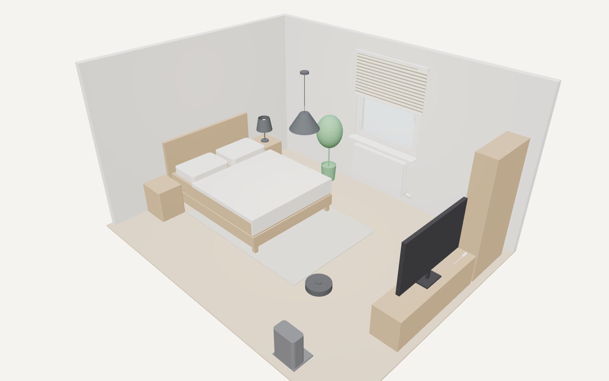
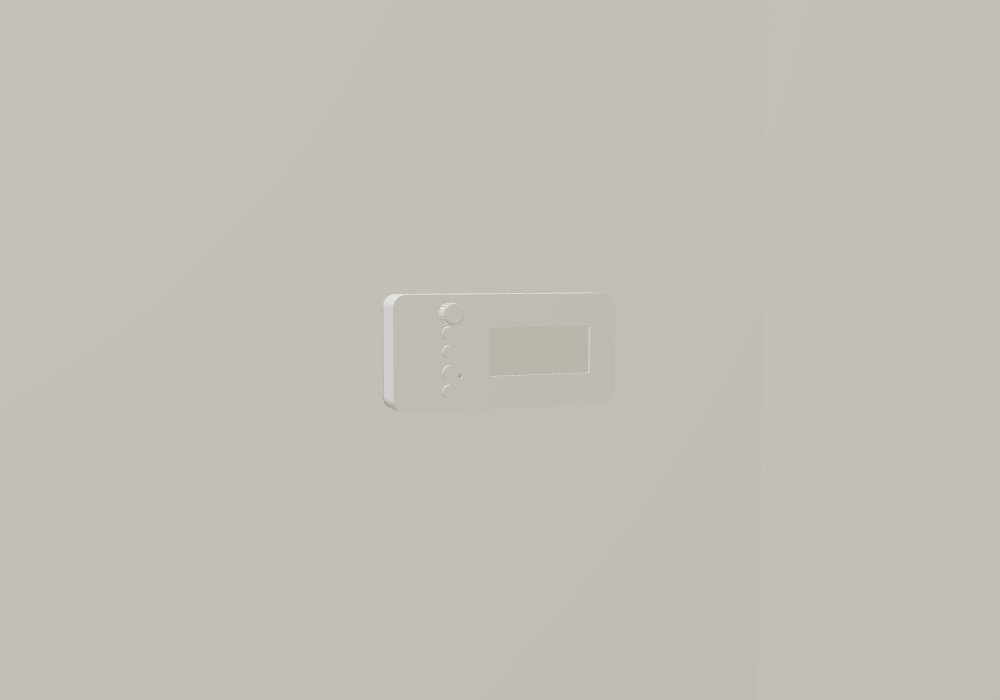

# 3D model of the room

The whole bedroom as a 3D model, with **every part in its own file** so you can reuse
any of them: drop the radiator into your own room, print the blind headrail, or swap in
your own furniture.



| File | What |
| --- | --- |
| `room.glb` | The complete room, every part a named node, in place (metres, glTF Y-up). Open it in Blender, [gltf-viewer.donmccurdy.com](https://gltf-viewer.donmccurdy.com) or the [web viewer](../docs/viewer/). |
| `parts/<name>.stl` | Each part on its own, in **mm**, in its own local coordinates. GitHub shows a 3D preview when you click one. |
| `parts/<name>.glb` | The same part with its colour, for Blender / three.js. |
| `room_layout.json` | Where every part sits in the room (4×4 matrix in mm, Z up), its size, group and description. |
| `devices/` | The real case STLs of the Room Panel, copied from its repo (see below). |
| `build_room.py` | Builds all of the above. Every size is a parameter at the top. |

## Rebuild or change it

```bash
pip install manifold3d trimesh numpy
python build_room.py
```

Change `ROOM_W`, `ROOM_D`, `ROOM_H`, the window, door and radiator sizes, or the panel
height at the top of the script and run it again. Each part is a small function
(`radiator()`, `trv()`, `blind_headrail()` …), so adding your own is a few lines.

## Coordinates

- **Room** (in `build_room.py` and `room_layout.json`): mm, Z up. `x` west → east,
  `y` south (door) → north (window), `z` floor → ceiling. The inside of the room is
  `0…4500 × 0…3600 × 0…2500`; walls sit outside that box.
- **Each part** (`parts/*.stl`): wall-mounted parts have their back on `z = 0` and face `+z`
  (the same convention as the Room Panel's case script). Floor-standing parts stand on `z = 0`,
  centred on x/y. Ceiling parts hang down from `z = 0`.
- **`room.glb`**: converted to glTF conventions (metres, Y up), so it opens the right way up
  everywhere.

## The Room Panel is the real case

The Room Panel is the room's only sensor and control device. It is not a stand-in: it is
the printable case from its own repo, placed next to the door at 1.4 m (light-switch
height), where its radar looks into the whole room.

| Device | Where in the room | Source |
| --- | --- | --- |
| Room Panel | South wall next to the door, 1.4 m | [gustavwrisberg/room-panel](https://github.com/gustavwrisberg/room-panel) `hardware/case/out/` |



To print it, use the files and instructions in that repo; the copies in `devices/` are only
for placing it in the room. They stay under the repo's CERN-OHL-S v2 licence. The e-paper
module behind the panel's window is a simple stand-in.

## Parts

Everything except the Room Panel is a simple stand-in with the right size, not a copy of
any product's design.

| Group | Part | What | Size (mm) | Files |
| --- | --- | --- | --- | --- |
| structure | `floor` | Floor slab, wood colour | 4700 × 3800 × 20 | [`floor.stl`](parts/floor.stl) · [glb](parts/floor.glb) |
| structure | `wall_north` | North wall with window opening | 4700 × 2500 × 100 | [`wall_north.stl`](parts/wall_north.stl) · [glb](parts/wall_north.glb) |
| structure | `wall_south` | South wall with door opening | 4700 × 2500 × 100 | [`wall_south.stl`](parts/wall_south.stl) · [glb](parts/wall_south.glb) |
| structure | `wall_west` | West wall | 3600 × 2500 × 100 | [`wall_west.stl`](parts/wall_west.stl) · [glb](parts/wall_west.glb) |
| structure | `wall_east` | East wall | 3600 × 2500 × 100 | [`wall_east.stl`](parts/wall_east.stl) · [glb](parts/wall_east.glb) |
| structure | `door` | Door leaf with handle | 890 × 2090 × 110 | [`door.stl`](parts/door.stl) · [glb](parts/door.glb) |
| window | `window_frame` | Window frame and inside window board | 1260 × 1320 × 230 | [`window_frame.stl`](parts/window_frame.stl) · [glb](parts/window_frame.glb) |
| window | `window_sash` | Opening sash (inward-opening, tilt/turn) | 1110 × 1210 × 56 | [`window_sash.stl`](parts/window_sash.stl) · [glb](parts/window_sash.glb) |
| window | `window_glass` | Double glazing | 1010 × 1110 × 24 | [`window_glass.stl`](parts/window_glass.stl) · [glb](parts/window_glass.glb) |
| window | `window_handle` | Window handle | 30 × 155 × 26 | [`window_handle.stl`](parts/window_handle.stl) · [glb](parts/window_handle.glb) |
| blinds | `blind_headrail` | Cellular blind headrail (IKEA HOPPVALS) with the motor housing on the right | 1300 × 65 × 55 | [`blind_headrail.stl`](parts/blind_headrail.stl) · [glb](parts/blind_headrail.glb) |
| blinds | `blind_fabric` | Cellular (honeycomb) blind fabric, shown 650 mm down | 1260 × 650 × 18 | [`blind_fabric.stl`](parts/blind_fabric.stl) · [glb](parts/blind_fabric.glb) |
| blinds | `blind_bottom_rail` | Bottom rail of the blind | 1260 × 25 × 26 | [`blind_bottom_rail.stl`](parts/blind_bottom_rail.stl) · [glb](parts/blind_bottom_rail.glb) |
| heating | `radiator` | Type-22 panel radiator, 1000 x 600 mm | 1000 × 600 × 100 | [`radiator.stl`](parts/radiator.stl) · [glb](parts/radiator.glb) |
| heating | `radiator_valve` | Valve body with M30 x 1.5 thread | 72 × 30 × 155 | [`radiator_valve.stl`](parts/radiator_valve.stl) · [glb](parts/radiator_valve.glb) |
| heating | `trv` | Smart radiator thermostat stand-in (IKEA LILJEBAGGE, Matter over Thread) | 101 × 54 × 54 | [`trv.stl`](parts/trv.stl) · [glb](parts/trv.glb) |
| lights | `pendant_lamp` | Ceiling pendant | 400 × 400 × 760 | [`pendant_lamp.stl`](parts/pendant_lamp.stl) · [glb](parts/pendant_lamp.glb) |
| lights | `bulb_pendant` | Smart bulb stand-in (IKEA KAJPLATS E27, Matter over Thread), ceiling | 95 × 95 × 132.5 | [`bulb_pendant.stl`](parts/bulb_pendant.stl) · [glb](parts/bulb_pendant.glb) |
| lights | `bedside_lamp` | Bedside table lamp | 280 × 280 × 440 | [`bedside_lamp.stl`](parts/bedside_lamp.stl) · [glb](parts/bedside_lamp.glb) |
| lights | `bulb_bedside` | Second smart bulb (bedside) | 95 × 95 × 132.5 | [`bulb_bedside.stl`](parts/bulb_bedside.stl) · [glb](parts/bulb_bedside.glb) |
| vacuum | `vacuum_dock` | Self-empty dock against the south wall | 340 × 300 × 420 | [`vacuum_dock.stl`](parts/vacuum_dock.stl) · [glb](parts/vacuum_dock.glb) |
| vacuum | `robot_vacuum` | Robot vacuum stand-in (Roborock with the core integration) | 352 × 351 × 105 | [`robot_vacuum.stl`](parts/robot_vacuum.stl) · [glb](parts/robot_vacuum.glb) |
| furniture | `rug` | Rug under the foot of the bed | 2400 × 1700 × 10 | [`rug.stl`](parts/rug.stl) · [glb](parts/rug.glb) |
| furniture | `bed` | Double bed 160 x 200 cm, headboard on the west wall | 2060 × 1640 × 1050 | [`bed.stl`](parts/bed.stl) · [glb](parts/bed.glb) |
| furniture | `bed_linen` | Duvet and pillows | 1940 × 1590 × 310 | [`bed_linen.stl`](parts/bed_linen.stl) · [glb](parts/bed_linen.glb) |
| furniture | `nightstand_south` | Nightstand | 450 × 400 × 500 | [`nightstand_south.stl`](parts/nightstand_south.stl) · [glb](parts/nightstand_south.glb) |
| furniture | `nightstand_north` | Nightstand with the bedside lamp | 450 × 400 × 500 | [`nightstand_north.stl`](parts/nightstand_north.stl) · [glb](parts/nightstand_north.glb) |
| furniture | `tv_bench` | TV bench | 1600 × 400 × 450 | [`tv_bench.stl`](parts/tv_bench.stl) · [glb](parts/tv_bench.glb) |
| furniture | `tv` | TV | 1240 × 200 × 870 | [`tv.stl`](parts/tv.stl) · [glb](parts/tv.glb) |
| furniture | `bookshelf` | Bookshelf | 800 × 300 × 1800 | [`bookshelf.stl`](parts/bookshelf.stl) · [glb](parts/bookshelf.glb) |
| furniture | `plant` | Plant by the window | 440 × 440 × 1186 | [`plant.stl`](parts/plant.stl) · [glb](parts/plant.glb) |
| hub | `ha_hub` | Home Assistant Green / mini PC | 112 × 112 × 32 | [`ha_hub.stl`](parts/ha_hub.stl) · [glb](parts/ha_hub.glb) |
| hub | `thread_radio` | Home Assistant Connect ZBT-2 (Thread) on a USB extension | 28 × 305 × 14 | [`thread_radio.stl`](parts/thread_radio.stl) · [glb](parts/thread_radio.glb) |
| devices | `room_panel_front_shell` | Room Panel (github.com/gustavwrisberg/room-panel), next to the door: radar, climate, light, CO2, controls | 145 × 70 × 21 | devices/ |
| devices | `room_panel_back_plate` | Room Panel (github.com/gustavwrisberg/room-panel), next to the door: radar, climate, light, CO2, controls | 145 × 70 × 12.4 | devices/ |
| devices | `room_panel_button_1` | Room Panel (github.com/gustavwrisberg/room-panel), next to the door: radar, climate, light, CO2, controls | 10.5 × 10.5 × 9.8 | devices/ |
| devices | `room_panel_button_2` | Room Panel (github.com/gustavwrisberg/room-panel), next to the door: radar, climate, light, CO2, controls | 10.5 × 10.5 × 9.8 | devices/ |
| devices | `room_panel_button_3` | Room Panel (github.com/gustavwrisberg/room-panel), next to the door: radar, climate, light, CO2, controls | 10.5 × 10.5 × 9.8 | devices/ |
| devices | `room_panel_button_4` | Room Panel (github.com/gustavwrisberg/room-panel), next to the door: radar, climate, light, CO2, controls | 10.5 × 10.5 × 9.8 | devices/ |
| devices | `room_panel_epaper` | Room Panel (github.com/gustavwrisberg/room-panel), next to the door: radar, climate, light, CO2, controls | 89.5 × 38 × 1.2 | devices/ |
| devices | `room_panel_knob` | Room Panel (github.com/gustavwrisberg/room-panel), next to the door: radar, climate, light, CO2, controls | 13 × 13 × 11 | devices/ |
